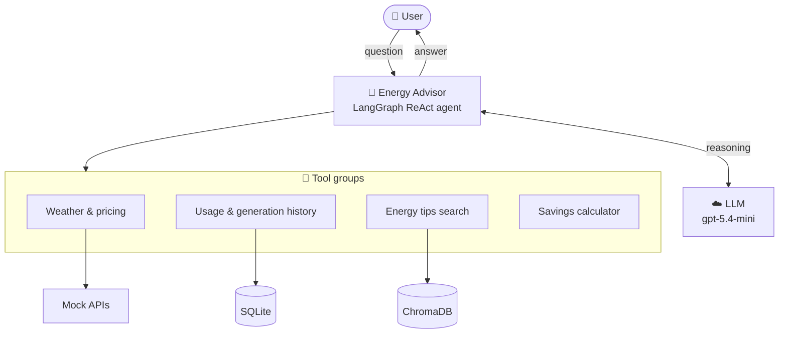
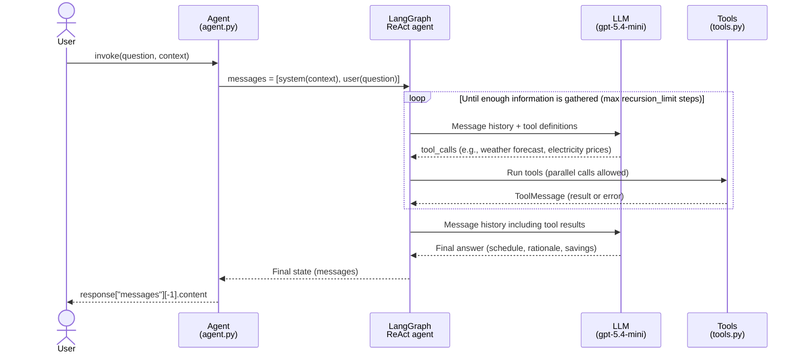
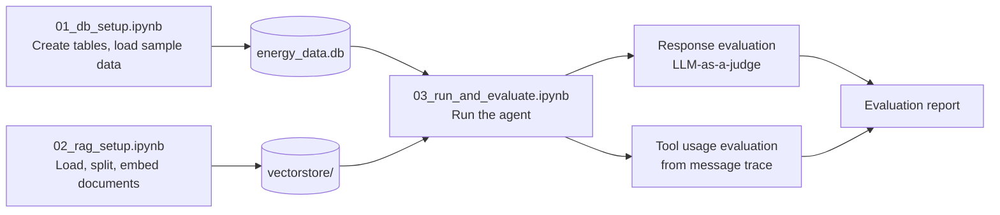
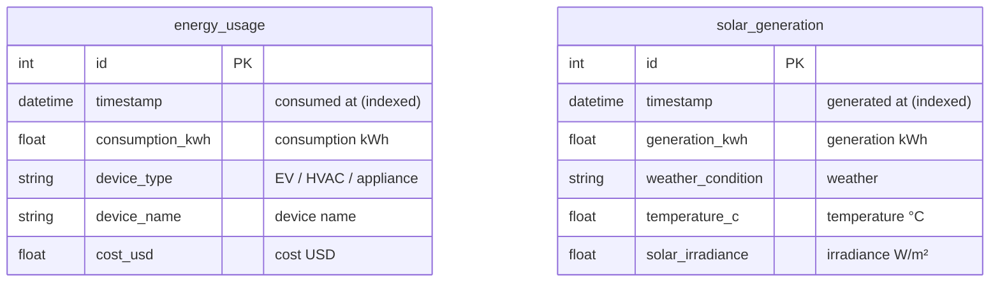
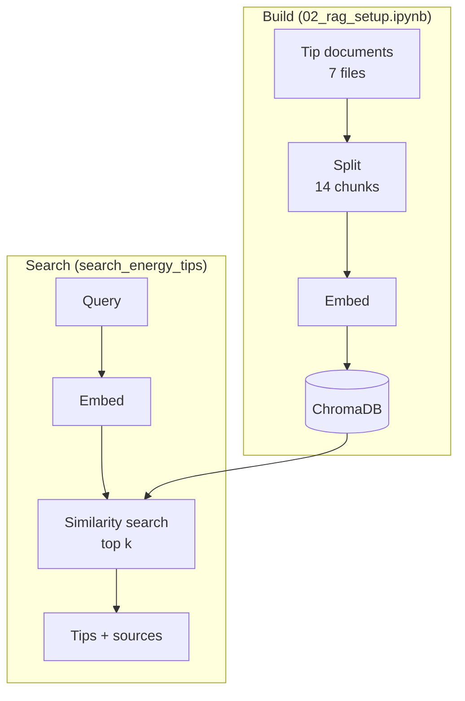
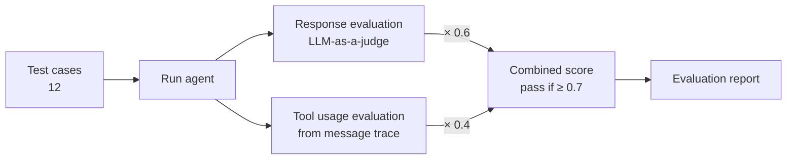

## EcoHome Energy Advisor

An AI-powered energy optimization agent that helps customers reduce electricity costs and environmental impact through personalized recommendations.

## Project Overview

EcoHome is a smart-home energy start-up that helps customers with solar panels, electric vehicles (EVs), and smart thermostats optimize their energy usage. The Energy Advisor agent provides personalized recommendations about when to run devices to minimize costs and carbon footprint.

### Key Technologies

- **LangChain**: Agent framework and tool integration
- **LangGraph**: Agent orchestration and workflow
- **ChromaDB**: Vector database for document retrieval
- **SQLAlchemy**: Database ORM and management
- **OpenAI**: LLM and embeddings
- **SQLite**: Local database storage

### Key Features

- **Weather Integration**: Uses weather forecasts to predict solar generation
- **Dynamic Pricing**: Considers time-of-day electricity prices for cost optimization
- **Historical Analysis**: Queries past energy usage patterns for personalized advice
- **RAG Pipeline**: Retrieves relevant energy-saving tips and best practices
- **Multi-device Optimization**: Handles EVs, HVAC, appliances, and solar systems
- **Cost Calculations**: Provides specific daily, monthly and annual savings estimates for usage reduction and load shifting

## System Architecture

### Overview



### Flow of a Single Question (ReAct Loop)



### Role of Each Notebook



## Project Structure

```
ecohome_solution/
├── models/
│   ├── __init__.py
│   └── energy.py              # Database models for energy data
├── data/
│   ├── documents/
│   │   ├── tip_device_best_practices.txt
│   │   ├── tip_energy_savings.txt
│   │   ├── tip_hvac_optimization.txt
│   │   ├── tip_smart_home_automation.txt
│   │   ├── tip_renewable_energy_integration.txt
│   │   ├── tip_seasonal_energy_management.txt
│   │   └── tip_energy_storage_optimization.txt
│   ├── energy_data.db         # SQLite database (created by 01_db_setup.ipynb)
│   └── vectorstore/           # ChromaDB vector store (created by 02_rag_setup.ipynb)
├── agent.py                   # Main Energy Advisor agent
├── tools.py                   # Agent tools (weather, pricing, database, RAG, savings)
├── requirements.txt           # Python dependencies
├── 01_db_setup.ipynb          # Database setup and sample data
├── 02_rag_setup.ipynb         # RAG pipeline setup
├── 03_run_and_evaluate.ipynb  # Agent running, testing and evaluation
├── README.md                  # This file (English)
└── README_ja.md               # Japanese version
```

## Setup Instructions

### 1. Install Dependencies

Use Python 3.11 (recommended), 3.12 or 3.13 and install the pinned versions:

```bash
pip install -r requirements.txt
```

### 2. Set Environment Variables

Create a `.env` file with your Vocareum API key:

```bash
VOCAREUM_API_KEY=your_vocareum_api_key_here
```

### 3. Run the Notebooks

Execute the notebooks in order:

1. **01_db_setup.ipynb** - Set up the database and populate with sample data
2. **02_rag_setup.ipynb** - Configure the RAG pipeline for energy tips
3. **03_run_and_evaluate.ipynb** - Run, test and evaluate the agent

## Agent Capabilities

### Tools Available

- **Weather Forecast**: Get hourly weather predictions and solar irradiance
- **Electricity Pricing**: Access time-of-day pricing data
- **Energy Usage Query**: Retrieve historical consumption data
- **Solar Generation Query**: Get past solar production data
- **Recent Energy Summary**: Summarize consumption (by device type) and solar generation over the last N hours
- **Energy Tips Search**: Find relevant energy-saving recommendations
- **Savings Calculator**: Compute daily, monthly and annual kWh/USD savings and percentages from **daily** kWh inputs. Supports usage reduction (fewer kWh) and load shifting (same kWh at a cheaper rate via `optimized_price_per_kwh`)

### Example Questions

The Energy Advisor can answer questions like:

- "When should I charge my electric car tomorrow to minimize cost and maximize solar power?"
- "What temperature should I set my thermostat on Wednesday afternoon if electricity prices spike?"
- "Suggest three ways I can reduce energy use based on my usage history."
- "How much can I save by running my dishwasher during off-peak hours?"

## Tool Groups

| Tool group                 | Tools (`tools.py`)                                                          | Backend                                                                 |
| -------------------------- | --------------------------------------------------------------------------- | ----------------------------------------------------------------------- |
| Weather & pricing          | `get_weather_forecast`, `get_electricity_prices`                            | Mock APIs (seeded synthetic data: same input returns the same values)   |
| Usage & generation history | `query_energy_usage`, `query_solar_generation`, `get_recent_energy_summary` | SQLite `data/energy_data.db` (SQLAlchemy / `models/energy.py`)          |
| Energy tips search         | `search_energy_tips`                                                        | ChromaDB `data/vectorstore/` (similarity search with OpenAI Embeddings) |
| Savings calculator         | `calculate_energy_savings`                                                  | None (calculation only)                                                 |

- The mock APIs seed their random generator with the date (weather: location + date), so repeated calls for the same date return the same forecast and prices.
- Both the LLM and the embeddings use the OpenAI-compatible API via Vocareum.
- ChromaDB stores the chunked and embedded `data/documents/*.txt` files produced by `02_rag_setup.ipynb`.

## SQLite Database (`data/energy_data.db`)



| Table              | Used by                                               | Populated by                                                  |
| ------------------ | ----------------------------------------------------- | ------------------------------------------------------------- |
| `energy_usage`     | `query_energy_usage`, `get_recent_energy_summary`     | `01_db_setup.ipynb` (sample data for the past 30 days)        |
| `solar_generation` | `query_solar_generation`, `get_recent_energy_summary` | `01_db_setup.ipynb` (past 30 days, based on weather patterns) |

- The two tables have no foreign-key relationship; each is queried independently by `timestamp`.
- Tables are defined in `models/energy.py` (SQLAlchemy), and connections are managed by the `DatabaseManager` class.
- **Peak hours differ between the sample data and the pricing tool.** Both use the same rates (peak $0.15/kWh, off-peak $0.10/kWh), but:
  - `cost_usd` in `energy_usage` applies the peak rate only during **device-specific** peak hours: EV 18:00-21:00, HVAC 12:00-17:00, appliance 19:00-22:00.
  - `get_electricity_prices` treats **06:00-22:00** as peak for every device.

  As a result, the average rate derived from the database (`total_cost_usd / total_consumption_kwh`, about $0.11/kWh for the EV) is lower than the tariff alone would suggest. Keep this in mind when comparing historical cost with tariff-based savings estimates.

### Energy Usage Table

- `id`: Record identifier (primary key)
- `timestamp`: When the energy was consumed
- `consumption_kwh`: Amount of energy used
- `device_type`: Type of device (EV, HVAC, appliance)
- `device_name`: Specific device name
- `cost_usd`: Cost at time of usage

### Solar Generation Table

- `id`: Record identifier (primary key)
- `timestamp`: When the energy was generated
- `generation_kwh`: Amount of solar energy produced
- `weather_condition`: Weather during generation
- `temperature_c`: Temperature at time of generation
- `solar_irradiance`: Solar irradiance level

## ChromaDB Knowledge Base (`data/vectorstore/`)

Energy-saving tip documents are embedded and stored as vectors, and the `search_energy_tips` tool retrieves them by semantic search (RAG).



### Documents (`data/documents/`)

| File                                   | Main topics                                                                  |
| -------------------------------------- | ---------------------------------------------------------------------------- |
| `tip_device_best_practices.txt`        | Delayed start for EVs, washers and dishwashers; using off-peak / solar hours |
| `tip_energy_savings.txt`               | Basic home energy saving: lighting, standby power, LEDs                      |
| `tip_hvac_optimization.txt`            | Thermostat settings, maintenance, HVAC scheduling                            |
| `tip_smart_home_automation.txt`        | Automation with smart thermostats and smart plugs                            |
| `tip_renewable_energy_integration.txt` | Shifting consumption to match solar generation, maximizing self-consumption  |
| `tip_seasonal_energy_management.txt`   | Seasonal energy saving and maintenance                                       |
| `tip_energy_storage_optimization.txt`  | Home battery charging and discharging strategies                             |

### Build and Search Settings

| Item            | Setting                                                                                          |
| --------------- | ------------------------------------------------------------------------------------------------ |
| Document loader | `TextLoader` (1 file = 1 document)                                                               |
| Chunking        | `RecursiveCharacterTextSplitter` (`chunk_size=1000`, `chunk_overlap=200`)                        |
| Embeddings      | `OpenAIEmbeddings` (via Vocareum, default model)                                                 |
| Storage         | `data/vectorstore/` (`chroma.sqlite3` and index files)                                           |
| Search          | `similarity_search(query, k=max_results)` (default `max_results=5`)                              |
| Returned fields | Chunk text, source file (`source`), rank-based relevance (top 2 high / next 2 medium / rest low) |

- If `data/vectorstore/chroma.sqlite3` does not exist, the store is built automatically from the documents on the first call to `search_energy_tips`.
- `02_rag_setup.ipynb` deletes the existing vector store before rebuilding it (`Chroma.from_documents` appends, so this prevents duplicate chunks). Re-run this notebook whenever you add or change documents.

## Evaluation Criteria

`03_run_and_evaluate.ipynb` evaluates each test case on two separate axes, response quality and tool usage, and decides pass/fail from a weighted combined score.



### Test Cases

There are 12 test cases across 7 categories. Each case has a question (`question`), the tools that should be used (`expected_tools`), and the elements the answer should contain (`expected_response`). All cases run with `Location: San Francisco, CA` as context.

| Category               | Tests | Main expected tools                                                     |
| ---------------------- | ----- | ----------------------------------------------------------------------- |
| `ev_charging`          | 2     | Weather forecast, electricity prices, usage history, savings calculator |
| `thermostat`           | 2     | Weather forecast, electricity prices, usage history, tips search        |
| `appliance_scheduling` | 2     | Electricity prices, weather forecast, recent energy summary             |
| `solar_maximization`   | 2     | Generation history, usage history, tips search, weather forecast        |
| `cost_savings`         | 2     | Savings calculator, usage history, electricity prices, tips search      |
| `energy_summary`       | 1     | Recent energy summary                                                   |
| `energy_tips`          | 1     | Tips search                                                             |

### 1. Response Evaluation (LLM-as-a-judge)

A judge LLM (`gpt-5.4`, a larger model than the agent's) scores four metrics on a 1-5 integer scale, based on the question, the final response, and the expected response.

| Metric           | What it checks                                                                                                      |
| ---------------- | ------------------------------------------------------------------------------------------------------------------- |
| **accuracy**     | Facts, numbers and calculations (kWh × $/kWh, daily → monthly → annual) are correct, consistent, and not fabricated |
| **relevance**    | Directly answers the question (device, date, goal) without off-topic content                                        |
| **completeness** | Covers every element listed in `expected_response`                                                                  |
| **usefulness**   | Specific, actionable advice (time windows, setpoints, savings, stated assumptions)                                  |

- Each metric is normalized to 0-1 (`(score - 1) / 4`), and their average is the **response score**.
- Besides scores, the judge returns strengths, weaknesses, missing elements, and improvement feedback as structured output.
- If the agent failed to return a response because of an error, every metric gets the minimum score (response score 0).

### 2. Tool Usage Evaluation (Deterministic)

The tools actually called are extracted from the agent's message trace and compared with `expected_tools`. No LLM is involved, so the same message trace always gets the same result. The agent's own tool choices can still vary between runs.

| Metric                   | Calculation                                                  | Meaning                          |
| ------------------------ | ------------------------------------------------------------ | -------------------------------- |
| **tool_appropriateness** | Expected tools among those called ÷ tools called (precision) | Did it avoid unnecessary tools?  |
| **tool_completeness**    | Expected tools actually called ÷ expected tools (recall)     | Did it call every required tool? |
| **tool_f1**              | Harmonic mean of the two                                     | Overall tool-usage score         |

- All counts are of distinct tools (duplicates removed).
- Missing tools, unexpected tools, repeated calls, and calls that returned errors are also detected and included in the feedback.

### 3. Combined Score and Pass/Fail

| Item                      | Value                                                                                                         |
| ------------------------- | ------------------------------------------------------------------------------------------------------------- |
| Combined score            | Response score × **0.6** + tool_f1 × **0.4** (0-1)                                                            |
| Pass threshold            | Combined score **≥ 0.7**                                                                                      |
| Strength / weakness rules | Response metrics: average ≥ 4.0 is a strength, < 3.5 a weakness; tool metrics: ≥ 0.9 strength, < 0.8 weakness |

### 4. Evaluation Report

`generate_evaluation_report()` aggregates the results and `display_evaluation_report()` prints them. The report contains:

1. Overall scores: combined score, response score, pass rate, metric averages
2. Scores by category
3. Per-test results: each metric, pass/fail, missing and unexpected tools
4. Strengths
5. Weaknesses
6. Recommendations: system-prompt improvements per metric or tool, etc.
7. Detailed feedback: response and tool-usage evaluation for each test

## Learning Objectives

What this project covers:

1. **Database Design**: Creating schemas for energy management systems
2. **API Integration**: Working with external weather and pricing APIs
3. **RAG Implementation**: Building retrieval-augmented generation pipelines
4. **Agent Development**: Creating intelligent agents with tool usage
5. **Evaluation Methods**: Testing and measuring agent performance
6. **Energy Optimization**: Understanding smart home energy management

## Contributing

This is a learning project. Feel free to:

- Add new tools and capabilities
- Improve the evaluation metrics
- Enhance the RAG pipeline
- Add more sophisticated optimization algorithms

## License

This project is for educational purposes as part of the Udacity Course curriculum.
