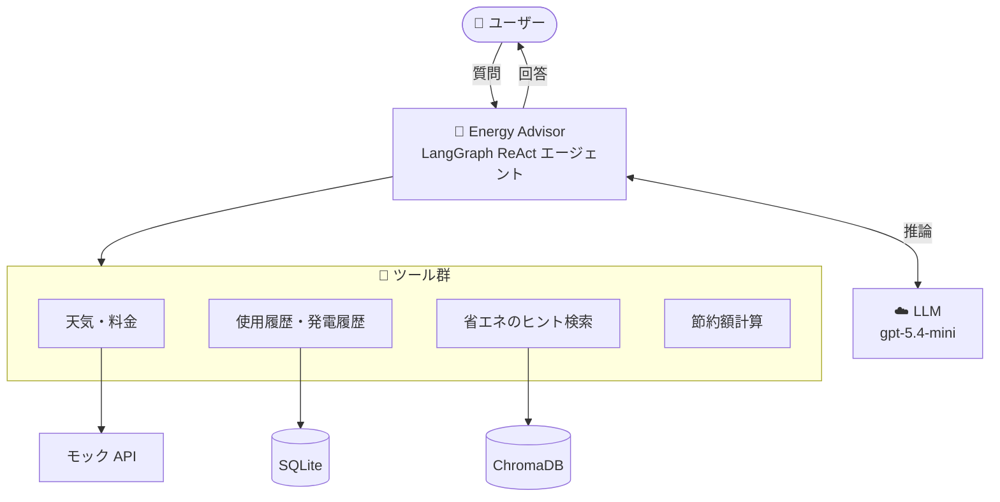
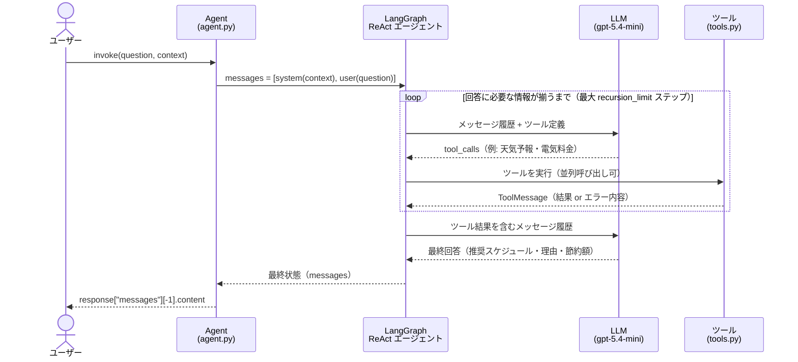
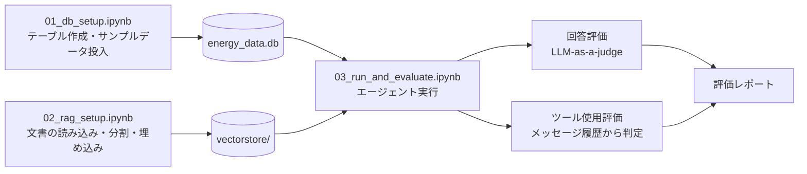
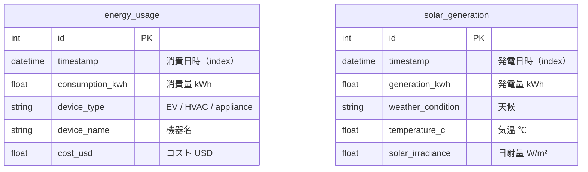
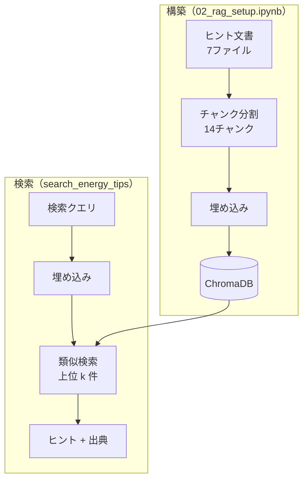
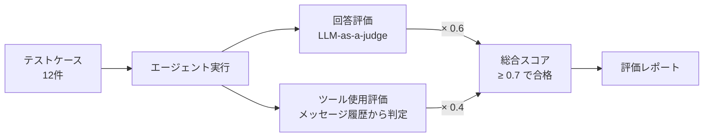

## EcoHome Energy Advisor

パーソナライズされた提案を通じて、顧客の電気料金と環境負荷の削減を支援する、AI搭載のエネルギー最適化エージェントです。

## プロジェクト概要

EcoHome は、ソーラーパネル・電気自動車（EV）・スマートサーモスタットを持つ顧客のエネルギー利用最適化を支援するスマートホーム・エネルギー分野のスタートアップです。Energy Advisor エージェントは、コストとカーボンフットプリントを最小化するために、いつ機器を稼働させるべきかをパーソナライズして提案します。

### 主な技術

- **LangChain**: エージェントフレームワークとツール連携
- **LangGraph**: エージェントのオーケストレーションとワークフロー
- **ChromaDB**: ドキュメント検索用のベクトルデータベース
- **SQLAlchemy**: データベースの ORM と管理
- **OpenAI**: LLM と埋め込み（Embeddings）
- **SQLite**: ローカルのデータベースストレージ

### 主な機能

- **天気予報との連携**: 天気予報を利用して太陽光発電量を予測
- **変動料金への対応**: 時間帯別の電気料金を考慮してコストを最適化
- **履歴分析**: 過去のエネルギー使用パターンを照会し、個別のアドバイスを提供
- **RAG パイプライン**: 関連する省エネのヒントやベストプラクティスを検索
- **複数機器の最適化**: EV、空調（HVAC）、家電、太陽光発電システムに対応
- **コスト計算**: 具体的な節約額の見積もりと ROI 分析を提供

## システム構成図

### 全体構成



### 1回の質問の処理フロー（ReAct ループ）



### ノートブックの役割



## プロジェクト構成

```
ecohome_starter/
├── models/
│   ├── __init__.py
│   └── energy.py              # エネルギーデータ用のデータベースモデル
├── data/
│   └── documents/
│       ├── tip_device_best_practices.txt
│       ├── tip_energy_savings.txt
│       ├── tip_hvac_optimization.txt
│       ├── tip_smart_home_automation.txt
│       ├── tip_renewable_energy_integration.txt
│       ├── tip_seasonal_energy_management.txt
│       └── tip_energy_storage_optimization.txt
├── agent.py                   # Energy Advisor エージェント本体
├── tools.py                   # エージェントのツール（天気、料金、データベース、RAG）
├── requirements.txt           # Python の依存パッケージ
├── 01_db_setup.ipynb         # データベースのセットアップとサンプルデータ
├── 02_rag_setup.ipynb        # RAG パイプラインのセットアップ
├── 03_run_and_evaluate.ipynb # エージェントの実行・テスト・評価
└── README.md                  # このファイル
```

## セットアップ手順

### 1. 依存パッケージのインストール

Python 3.11（推奨）、3.12、3.13 のいずれかを使用し、バージョン固定されたパッケージをインストールしてください。

```bash
pip install -r requirements.txt
```

### 2. 環境変数の設定

Vocareum の API キーを記載した `.env` ファイルを作成します。

```bash
VOCAREUM_API_KEY=your_vocareum_api_key_here
```

### 3. ノートブックの実行

以下の順番でノートブックを実行してください。

1. **01_db_setup.ipynb** - データベースをセットアップし、サンプルデータを投入
2. **02_rag_setup.ipynb** - 省エネのヒント用の RAG パイプラインを構成
3. **03_run_and_evaluate.ipynb** - エージェントを実行・テスト・評価

## エージェントの機能

### 利用可能なツール

- **天気予報**: 1時間ごとの天気予報と日射量を取得
- **電気料金**: 時間帯別の料金データにアクセス
- **エネルギー使用量の照会**: 過去の消費データを取得
- **太陽光発電量の照会**: 過去の太陽光発電データを取得
- **省エネのヒント検索**: 関連する省エネの提案を検索
- **節約額計算**: 見込まれるコスト削減額を算出

### 質問例

Energy Advisor は次のような質問に答えられます。

- 「コストを最小化し太陽光発電を最大限活用するには、明日いつ電気自動車を充電すべき？」
- 「水曜日の午後に電気料金が急騰する場合、サーモスタットを何度に設定すべき？」
- 「私の使用履歴をもとに、エネルギー使用量を減らす方法を3つ提案して。」
- 「食洗機をオフピーク時間帯に動かすと、どれくらい節約できる？」

## ツール群

| ツール群           | ツール（`tools.py`）                                                        | 接続先                                                          |
| ------------------ | --------------------------------------------------------------------------- | --------------------------------------------------------------- |
| 天気・料金         | `get_weather_forecast`, `get_electricity_prices`                            | モック API（乱数ベースの擬似データ）                            |
| 使用履歴・発電履歴 | `query_energy_usage`, `query_solar_generation`, `get_recent_energy_summary` | SQLite `data/energy_data.db`（SQLAlchemy / `models/energy.py`） |
| 省エネのヒント検索 | `search_energy_tips`                                                        | ChromaDB `data/vectorstore/`（OpenAI Embeddings で類似検索）    |
| 節約額計算         | `calculate_energy_savings`                                                  | なし（計算のみ）                                                |

- LLM と Embeddings は、どちらも Vocareum 経由の OpenAI 互換 API を利用します。
- ChromaDB には、`02_rag_setup.ipynb` で `data/documents/*.txt` をチャンク分割・埋め込みしたものが保存されています。

## SQLite データベース（`data/energy_data.db`）



| テーブル           | 参照するツール                                        | データの投入元                                                  |
| ------------------ | ----------------------------------------------------- | --------------------------------------------------------------- |
| `energy_usage`     | `query_energy_usage`, `get_recent_energy_summary`     | `01_db_setup.ipynb`（過去30日分のサンプル）                     |
| `solar_generation` | `query_solar_generation`, `get_recent_energy_summary` | `01_db_setup.ipynb`（過去30日分・天候パターンに基づくサンプル） |

- 2つのテーブルに外部キーによる関連はなく、`timestamp` を軸にそれぞれ独立して照会されます。
- テーブル定義は `models/energy.py`（SQLAlchemy）、接続管理は `DatabaseManager` クラスが担います。

### Energy Usage テーブル

- `id`: レコードの識別子（主キー）
- `timestamp`: エネルギーが消費された日時
- `consumption_kwh`: 使用したエネルギー量
- `device_type`: 機器の種類（EV、HVAC、家電）
- `device_name`: 具体的な機器名
- `cost_usd`: 使用時点でのコスト

### Solar Generation テーブル

- `id`: レコードの識別子（主キー）
- `timestamp`: エネルギーが発電された日時
- `generation_kwh`: 太陽光による発電量
- `weather_condition`: 発電時の天候
- `temperature_c`: 発電時の気温
- `solar_irradiance`: 日射量

## ChromaDB ナレッジベース（`data/vectorstore/`）

省エネのヒント文書をベクトル化して保存し、`search_energy_tips` ツールから意味検索（RAG）で参照します。



### 収録文書（`data/documents/`）

| ファイル                               | 主な内容                                                             |
| -------------------------------------- | -------------------------------------------------------------------- |
| `tip_device_best_practices.txt`        | EV・洗濯機・食洗機などの予約運転、オフピーク／太陽光発電時間帯の活用 |
| `tip_energy_savings.txt`               | 照明・待機電力・LED 化など、家庭での基本的な省エネ                   |
| `tip_hvac_optimization.txt`            | サーモスタット設定、メンテナンス、空調のスケジューリング             |
| `tip_smart_home_automation.txt`        | スマートサーモスタットやスマートプラグによる自動化                   |
| `tip_renewable_energy_integration.txt` | 太陽光発電に合わせた電力消費のシフト、自家消費の最大化               |
| `tip_seasonal_energy_management.txt`   | 季節ごとの省エネとメンテナンス                                       |
| `tip_energy_storage_optimization.txt`  | 家庭用蓄電池の充放電戦略                                             |

### 構成と検索の設定

| 項目           | 設定                                                                                                 |
| -------------- | ---------------------------------------------------------------------------------------------------- |
| 文書の読み込み | `TextLoader`（1ファイル = 1ドキュメント）                                                            |
| チャンク分割   | `RecursiveCharacterTextSplitter`（`chunk_size=1000`, `chunk_overlap=200`）                           |
| 埋め込み       | `OpenAIEmbeddings`（Vocareum 経由、既定モデル）                                                      |
| 保存先         | `data/vectorstore/`（`chroma.sqlite3` とインデックスファイル）                                       |
| 検索方法       | `similarity_search(query, k=max_results)`（既定 `max_results=5`）                                    |
| 返却内容       | チャンク本文、出典ファイル（`source`）、順位に応じた関連度（上位2件 high／次の2件 medium／以降 low） |

- `data/vectorstore/chroma.sqlite3` が存在しない場合は、`search_energy_tips` の初回呼び出し時に文書から自動で構築されます。
- `02_rag_setup.ipynb` は既存のベクトルストアを削除してから再構築します（`Chroma.from_documents` は追記型のため、チャンクの重複を防ぐ目的）。文書を追加・変更したときは、このノートブックを再実行してください。

## 評価基準

`03_run_and_evaluate.ipynb` では、テストケースごとに「回答の質」と「ツールの使い方」を別々に評価し、両者を重み付けした総合スコアで合否を判定します。



### テストケース

7カテゴリ・計12件です。各ケースは、質問（`question`）、使うべきツール（`expected_tools`）、回答に含めるべき要素（`expected_response`）を持ちます。すべて `Location: San Francisco, CA` をコンテキストとして実行します。

| カテゴリ               | 件数 | 主な期待ツール                             |
| ---------------------- | ---- | ------------------------------------------ |
| `ev_charging`          | 2    | 天気予報、電気料金、使用履歴、節約額計算   |
| `thermostat`           | 2    | 天気予報、電気料金、使用履歴、ヒント検索   |
| `appliance_scheduling` | 2    | 電気料金、天気予報、直近の使用サマリー     |
| `solar_maximization`   | 2    | 発電履歴、使用履歴、ヒント検索、天気予報   |
| `cost_savings`         | 2    | 節約額計算、使用履歴、電気料金、ヒント検索 |
| `energy_summary`       | 1    | 直近の使用サマリー                         |
| `energy_tips`          | 1    | ヒント検索                                 |

### 1. 回答評価（LLM-as-a-judge）

評価用 LLM（`gpt-5.4`、エージェントより大きいモデル）が、質問・最終回答・期待される回答をもとに、4つの指標を 1〜5 の整数で採点します。

| 指標                       | 評価内容                                                                            |
| -------------------------- | ----------------------------------------------------------------------------------- |
| **accuracy**（正確性）     | 事実・数値・計算（kWh × $/kWh、日 → 月 → 年の換算など）が正しく、矛盾や捏造がないか |
| **relevance**（関連性）    | 質問（機器・日付・目的）に直接答えており、無関係な内容がないか                      |
| **completeness**（網羅性） | `expected_response` に挙げた要素をすべて含んでいるか                                |
| **usefulness**（有用性）   | 時間帯・設定温度・節約額・前提条件など、具体的で実行しやすいアドバイスか            |

- 各指標を 0〜1 に正規化し（`(score - 1) / 4`）、その平均を**回答スコア**とします。
- 評価用 LLM は、スコアに加えて強み・弱み・不足要素・改善フィードバックも構造化出力で返します。
- エージェントがエラーで回答を返せなかった場合は、全指標を最低点（回答スコア 0）とします。

### 2. ツール使用評価（決定的な評価）

エージェントのメッセージ履歴から実際に呼ばれたツールを取り出し、`expected_tools` と比較します。LLM を使わないため、結果は毎回同じになります。

| 指標                     | 計算方法                                                      | 意味                           |
| ------------------------ | ------------------------------------------------------------- | ------------------------------ |
| **tool_appropriateness** | 期待ツールに含まれる呼び出し数 ÷ 呼び出したツール数（適合率） | 不要なツールを呼んでいないか   |
| **tool_completeness**    | 実際に呼ばれた期待ツール数 ÷ 期待ツール数（再現率）           | 必要なツールを漏れなく呼んだか |
| **tool_f1**              | 上記2つの調和平均                                             | ツール使用の総合評価           |

- 数はいずれも、重複を除いたツールの種類で数えます。
- あわせて、不足ツール、想定外のツール、同じツールの重複呼び出し、エラーになった呼び出しを検出し、フィードバックに含めます。

### 3. 総合スコアと合否

| 項目             | 値                                                                                         |
| ---------------- | ------------------------------------------------------------------------------------------ |
| 総合スコア       | 回答スコア × **0.6** ＋ tool_f1 × **0.4**（0〜1）                                          |
| 合格ライン       | 総合スコア **0.7 以上**                                                                    |
| 強み・弱みの判定 | 回答指標は平均 4.0 以上で強み・3.5 未満で弱み、ツール指標は 0.9 以上で強み・0.8 未満で弱み |

### 4. 評価レポート

`generate_evaluation_report()` で集計し、`display_evaluation_report()` で表示します。レポートには次の内容が含まれます。

1. 全体スコア: 総合スコア、回答スコア、合格率、各指標の平均
2. カテゴリ別スコア
3. テストごとの結果: 各指標、合否、不足ツール・想定外のツール
4. 強み
5. 弱み
6. 改善提案: 指標やツールごとの、システムプロンプトの改善案など
7. 詳細フィードバック: テストごとの回答評価とツール使用評価

## 学習目標

このプロジェクトを通じて、学んだことをまとめます。

1. **データベース設計**: エネルギー管理システム向けのスキーマ作成
2. **API 連携**: 外部の天気・料金 API の活用
3. **RAG の実装**: 検索拡張生成（Retrieval-Augmented Generation）パイプラインの構築
4. **エージェント開発**: ツールを使うインテリジェントなエージェントの作成
5. **評価手法**: エージェントの性能のテストと測定
6. **エネルギー最適化**: スマートホームのエネルギー管理の理解

## コントリビューション

これは学習用プロジェクトです。以下のような改善を自由に行ってください。

- 新しいツールや機能の追加
- 評価指標の改善
- RAG パイプラインの強化
- より高度な最適化アルゴリズムの追加

## ライセンス

本プロジェクトは、Udacity Course 2 カリキュラムの一環として教育目的で提供されています。
